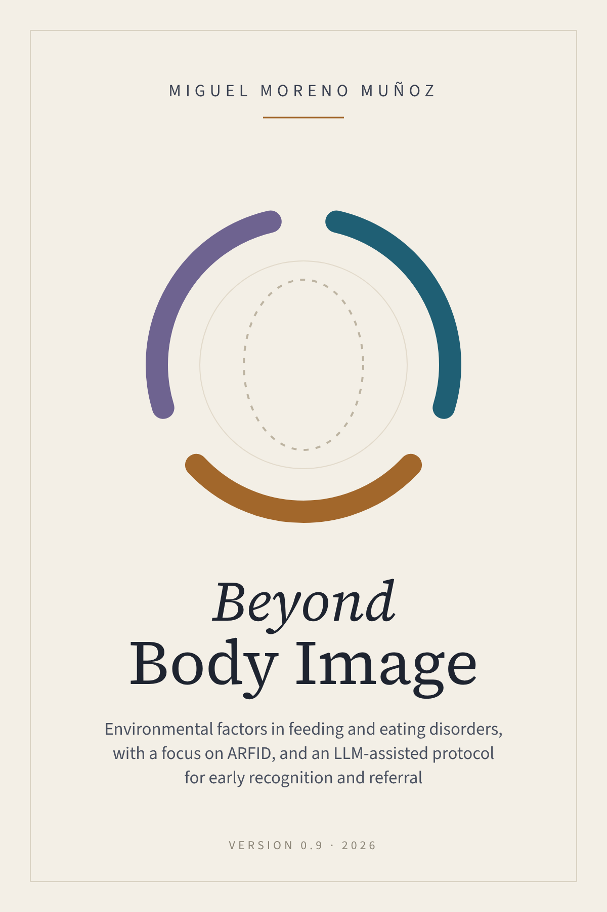

# Beyond Body Image

**Environmental Factors in Feeding and Eating Disorders, with a Focus on ARFID, and an LLM-Assisted Protocol for Early Recognition and Referral**

Miguel Moreno-Muñoz · Universidad de Granada · [ORCID 0000-0002-0746-9587](https://orcid.org/0000-0002-0746-9587)

An open, evidence-graded book on the environmental conditions in which feeding and eating disorders arise in adolescence, with a focus on avoidant/restrictive food intake disorder (ARFID), a condition that public debate on social media and eating, framed around body image, leaves out. It combines an academic essay, a practical guide for health and education professionals, and an interactive toolkit in which a language model helps adults organise what they have noticed and take it to the right professional. The book does not provide diagnosis.

**Read online:** <https://arfid26.vercel.app/> (canonical edition) · mirrors: [GitHub Pages](https://utilizas.github.io/arfid/) · [Netlify](https://arfid26.netlify.app/) · [Cloudflare](https://arfid26.utilizas.workers.dev)

<strong>Cover</strong>

 

## This repository

This repository holds the **rendered HTML edition** produced with [Quarto](https://quarto.org), which GitHub Pages and the mirrors serve as is. The source files (Quarto, R and BibTeX), the figure and simulation code and the verification log are included in the [archived release on Zenodo](https://doi.org/10.5281/zenodo.24436227).

## Status

Version 0.9 (22 November 2026) is a pre-review edition. All chapters are complete, but the book has not yet been peer reviewed and the toolkit has not yet been evaluated. If you are worried about a young person's eating, see [If you are worried · Si te preocupa](https://arfid26.vercel.app/worried.html).

## How to cite

> Moreno Muñoz, M. (2026). *Beyond body image: Environmental factors in feeding and eating disorders, with a focus on ARFID, and an LLM-assisted protocol for early recognition and referral* (Version 0.9) [Computer software and online book]. Zenodo. https://doi.org/10.5281/zenodo.24436227

Please cite the archived release, or link to the canonical edition, rather than a mirror.

## Licence

© 2026 Miguel Moreno Muñoz.  
Text, figures, code and toolkit are released under the [Creative Commons Attribution-NonCommercial-ShareAlike 4.0 International licence (CC BY-NC-SA 4.0)](https://creativecommons.org/licenses/by-nc-sa/4.0/), the same licence as the Zenodo record. The repository's licence field is empty because GitHub's licence picker does not offer this licence.

## Feedback

Corrections and suggestions are welcome as [issues](https://github.com/utilizas/arfid/issues).
